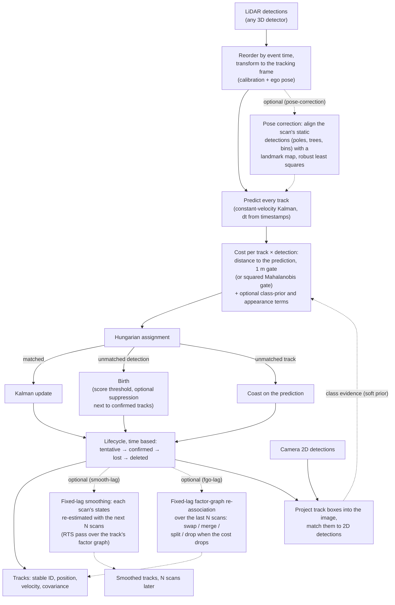

# Robot Perception

[](https://github.com/rsasaki0109/robot-perception/actions/workflows/ci.yml)

[](#license)

**Multi-object tracking for robots, in Rust.** Feed `factor-tracker` timestamped detections from a LiDAR or camera detector. Get track IDs, positions, velocities, and covariance in a common frame for 3D LiDAR tracking, or tracked image boxes in 2D. Camera detections can associate with 3D LiDAR tracks and supply class evidence.

[Try the camera demo](https://rsasaki0109.github.io/robot-perception/) · [CLI and Rust API](docs/usage.md) · [ROS 2](ros2/factor_tracker_ros) · [Benchmark reproduction](docs/evaluation.md)


On this CODa clip, the AB3DMOT-style baseline made 25 ID switches with a median velocity error of 0.17 m/s. `factor-tracker` with 0.5 s smoothing made 6 switches with 0.13 m/s error. Both use CODa PV-RCNN detections, with their detection settings selected on development data. See [Results](#results) for the full evaluation and its limits.

## Quick start

Clone the repository with Rust 1.89 or newer. The synthetic examples run on CPU.

```sh
git clone https://github.com/rsasaki0109/robot-perception.git
cd robot-perception
cargo run --release -p factor-tracker -- cam-demo --out-dir cam-demo-out
```

Open `cam-demo-out/report.html` to compare LiDAR-only, camera-associated, and camera-assisted tracking. The run also generates a calibration file and a JSONL recording you can feed through the live interface.

```sh
cargo run --release -p factor-tracker -- stream --setup cam-demo-out/setup.json \
  < cam-demo-out/inputs.jsonl > cam-demo-out/live-tracks.jsonl
```

Use the same stdin/stdout interface from a simulator or a detector process. Robot Native Engine's Go2 people example uses it in a closed-loop simulation. See the [stream schema and camera modes](docs/camera-lidar.md) and the [Go2 integration](https://github.com/rsasaki0109/RobotNativeEngine/blob/claude/relaxed-cerf-z71crt/examples/151_go2_people/README.md).

For standalone 2D and 3D tracking examples, run `cargo run -p factor-tracker -- demo --out-dir demo-out` and open the generated HTML views.

## Ways to integrate

| Interface | Use it for |
| --- | --- |
| [CLI](docs/usage.md) | Live JSONL tracking, deterministic replay, evaluation, and HTML reports |
| [Rust crates](docs/architecture.md) | Embed the CPU-only tracker in a Rust application. The core depends on `nalgebra` and `thiserror`. |
| [ROS 2 node](ros2/factor_tracker_ros) | Consume detections with TF and publish live tracks and optional delayed smoothed tracks |
| [Browser demo](https://rsasaki0109.github.io/robot-perception/) | Track people in image coordinates with the WebAssembly 2D tracker |

## Tracking options

- **Per-scan tracking** uses constant-velocity Kalman prediction, gated Hungarian assignment, and a timestamp-based track lifecycle.
- **Fixed-lag smoothing** estimates positions and velocities using subsequent scans. On the CODa evaluation, a five-scan lag (0.5 s) lowered median velocity error from 0.218 to 0.155 m/s on development windows and from 0.129 to 0.099 m/s on held-out windows.
- **Fixed-lag re-association** revisits recent assignment decisions to correct track identities.
- **Ego-pose correction** uses static landmarks supplied by the detector to reduce pose jitter. On the CODa pose-noise test (1° and 0.1 m), held-out HOTA was 0.767 with correction and 0.688 without.
- **Camera association** projects 3D track boxes into the image. Camera-assisted mode uses the associated detections as class evidence. The 3D position and its covariance are estimated from LiDAR measurements.

## Results

### nuScenes (standard benchmark)

Pedestrians on the nuScenes validation split with the MEGVII detections
(nuScenes' official tracking baseline input), scored by the official devkit.
factor-tracker's settings were chosen on half of the scenes and the other
half scored once; Chiu et al. ran with their published setting.

| tracker | held-out half AMOTA | AMOTP (m) | recall | MOTA | ID switches | whole split AMOTA |
| --- | --- | --- | --- | --- | --- | --- |
| AB3DMOT (official baseline results) | 0.109 | 1.738 | 0.242 | 0.135 | 448 | 0.094 |
| Chiu et al. (challenge winner, NeurIPS 2019) | 0.721 | 0.570 | 0.780 | 0.622 | 143 | 0.754 |
| **factor-tracker** | **0.768** | **0.417** | **0.804** | **0.643** | **124** | **0.798** |

The detections' velocities are used as measurements (`--velocity-std`).
Reproduction and the tuning steps: [`docs/evaluation.md`](docs/evaluation.md).

### CODa (robot)

Pedestrian tracking on 8 CODa windows, **same detector for every tracker**
(CODa PV-RCNN first stage on CPU). Velocity: median error against the
labels.

| tracker | detections (NMS IoU, score) | dev HOTA | dev IDF1 | dev ID switches | dev velocity (m/s) | held-out HOTA | held-out IDF1 | held-out ID switches | held-out velocity (m/s) |
| --- | --- | --- | --- | --- | --- | --- | --- | --- | --- |
| Kalman + Mahalanobis gate | 0.1, >= 0.4 | 0.600 | 0.722 | 1151 | 0.224 | 0.745 | 0.888 | 22 | 0.129 |
| AB3DMOT-style | 0.1, >= 0.4 | 0.618 | 0.746 | 987 | 0.227 | 0.764 | 0.882 | 28 | 0.133 |
| factor-tracker | 0.3, >= 0.5 | 0.628 | 0.772 | 773 | 0.218 | 0.777 | 0.902 | **18** | 0.129 |
| + 0.5 s smoothing | 0.3, >= 0.5 | 0.638 | 0.773 | 767 | 0.155 | **0.782** | 0.905 | **18** | **0.099** |
| **+ 0.5 s smoothing + pose correction** | 0.3, >= 0.5 | **0.640** | **0.793** | **562** | **0.153** | 0.774 | **0.908** | **18** | 0.102 |

factor-tracker runs with distance association and no new track within 0.8 m
of a confirmed one, which absorbs the duplicate boxes of the looser NMS.
Each tracker uses the detection setting that is best for it on dev (5
windows); held-out (3 windows) was scored once per setting. Pose correction
helps where the given poses jitter (two dev windows) and costs a little where
they are clean (held-out). The detector was trained on most of these scans,
so absolute numbers are optimistic for every tracker. Details:
[`docs/evaluation.md`](docs/evaluation.md).

## How it works

Per LiDAR scan (details: [`docs/algorithms.md`](docs/algorithms.md),
[`docs/camera-lidar.md`](docs/camera-lidar.md)):



## Demos

<p align="center">
  
</p>
<p align="center"><em>Camera + LiDAR on a wheeled robot (CODa seq 20, Ouster OS1-128).</em></p>

<p align="center">
  
</p>
<p align="center"><em>Livox Mid-360 + camera on a quadruped (GrandTour ETH-2); see <a href="docs/mid360.md"><code>docs/mid360.md</code></a>.</em></p>

## Documentation

- [Mid-360 and RealSense detector adapter](docs/solid_state_detectors.md)
- [`docs/usage.md`](docs/usage.md): CLI, Rust API, input/output, algorithm overview
- [`docs/architecture.md`](docs/architecture.md): design, scope, assumptions, limitations, references
- [`docs/algorithms.md`](docs/algorithms.md), [`docs/data-format.md`](docs/data-format.md), [`docs/camera-lidar.md`](docs/camera-lidar.md)
- [`docs/datasets.md`](docs/datasets.md), [`docs/evaluation.md`](docs/evaluation.md), [`docs/detector_training.md`](docs/detector_training.md)
- [`ROADMAP.md`](ROADMAP.md)

## License

Code: MIT OR Apache-2.0, at your option ([LICENSE-MIT](LICENSE-MIT),
[LICENSE-APACHE](LICENSE-APACHE)). The animations contain dataset images:
CODa ([CC BY-NC-SA 4.0](https://creativecommons.org/licenses/by-nc-sa/4.0/),
Zhang et al.) and [GrandTour](https://grand-tour.leggedrobotics.com) (MIT).
